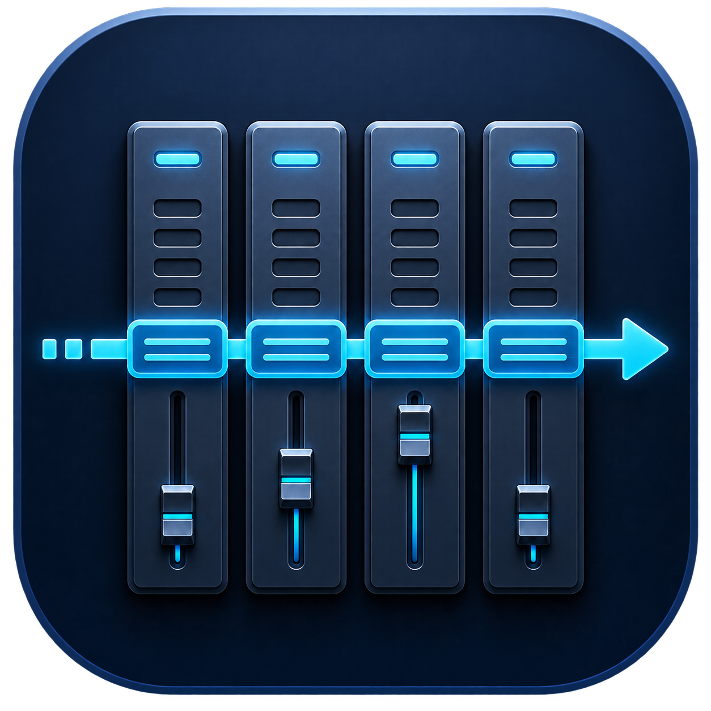
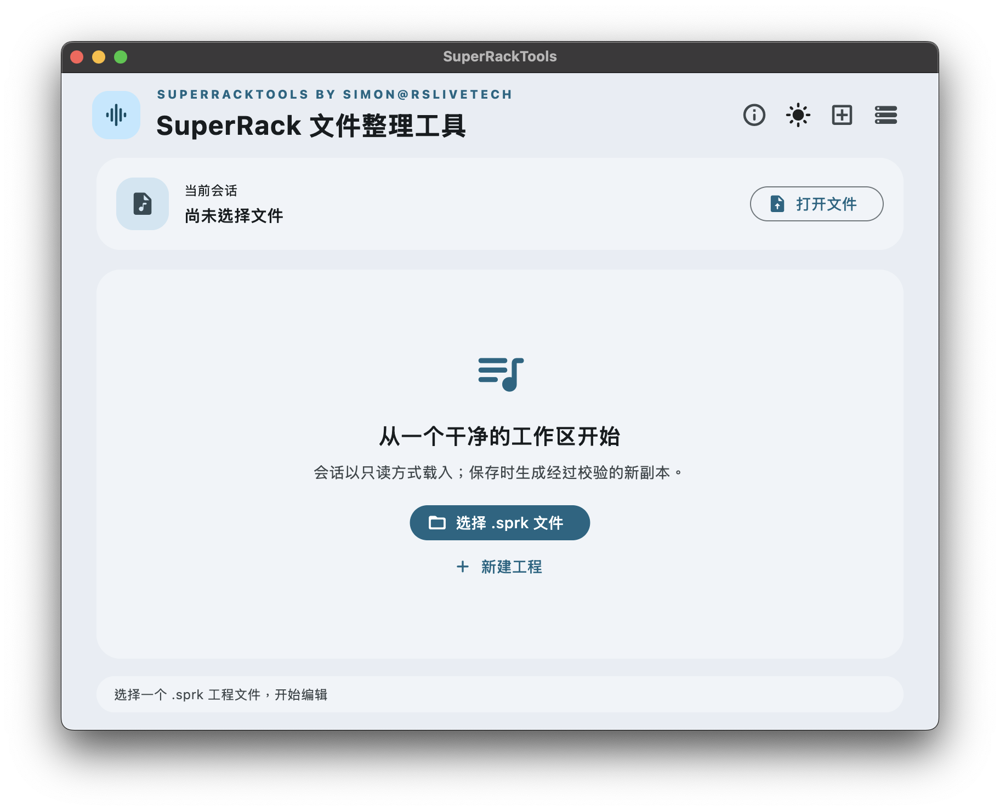
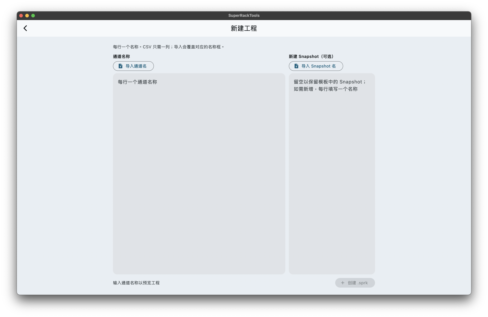
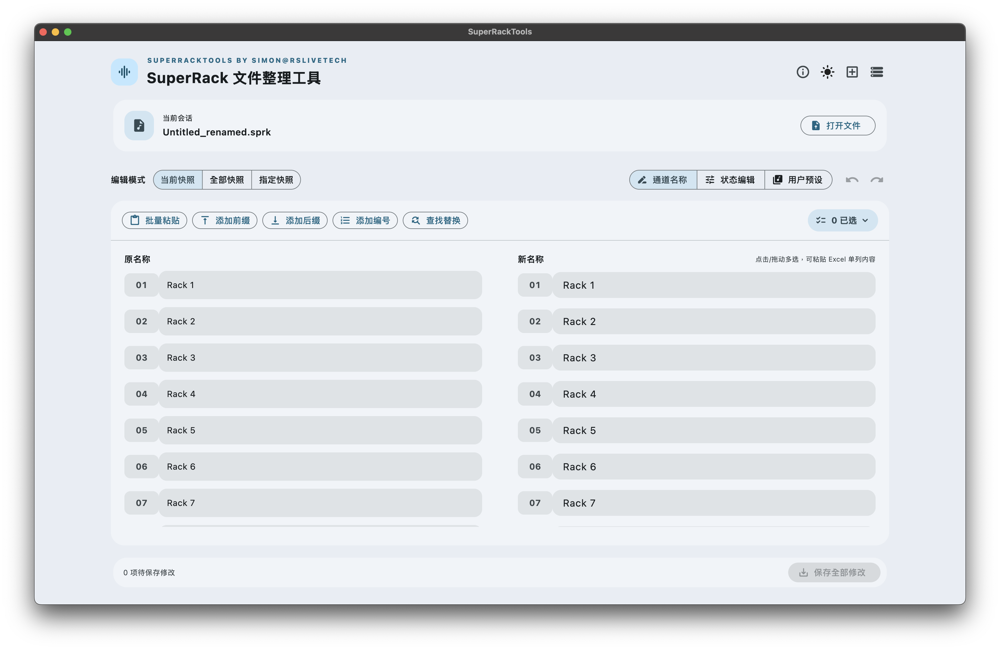
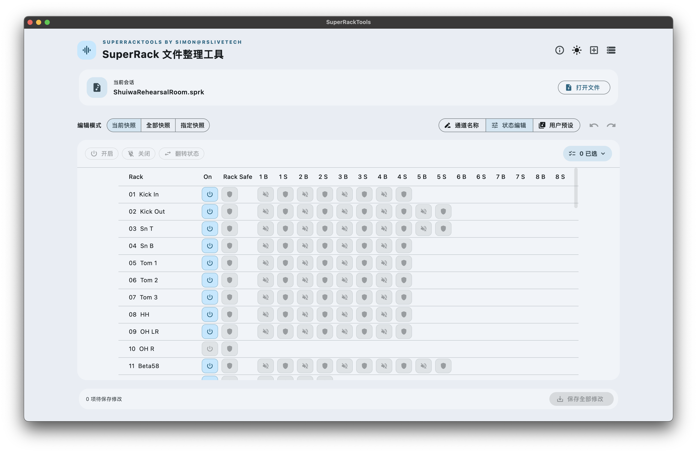
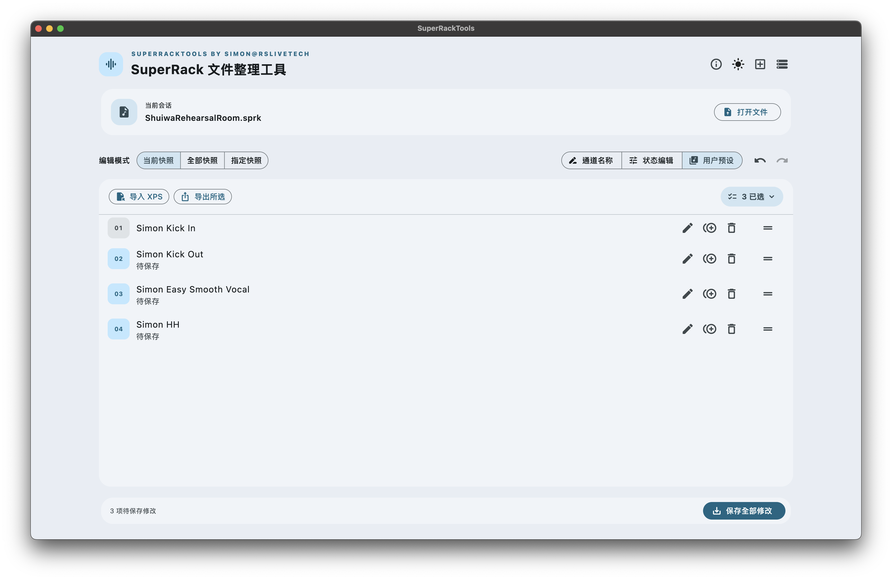

  
  <h1>SuperRackTools</h1>
  
<strong>便捷批量编辑 SuperRack 会话</strong>

  

    
    
    
  

SuperRackTools 是一款用于编辑 Waves SuperRack `.sprk` 会话的桌面工具。你可以集中整理通道名称、批量调整 Snapshot 状态和管理 User Presets，再将结果保存为一个新的会话文件。

## 功能

<table>
  <tr>
    <td width="50%" align="center">
      
       <strong>新建工程</strong> 从纯文本或 CSV 导入通道名称，并可选添加多个 Snapshot。
    </td>
    <td width="50%" align="center">
      
       <strong>通道名称</strong> 批量添加前后缀、编号、查找替换，或粘贴 Excel 单列内容。
    </td>
  </tr>
  <tr>
    <td width="50%" align="center">
      
       <strong>状态矩阵</strong> 集中查看并批量调整 Rack 开关、Recall Safe 和插件 Bypass。
    </td>
    <td width="50%" align="center">
      
       <strong>用户预设</strong> 重排、复制、重命名或删除用户预设，也可从 XPS 文件导入或导出。
    </td>
  </tr>
</table>

## 安心编辑

- **原文件保留**：编辑结果保存为新 `.sprk` 文件，不会覆盖打开的原始会话。
- **保存前检查**：写入完成后会检查 SQLite 完整性和外键关系。
- **避免编辑占用中的会话**：会检查 WAL、SHM 和 journal 文件，提示可能仍被 SuperRack 使用的数据库。

## 下载与安装

前往项目的 [Releases 页面](../../releases/latest)，按系统和处理器架构选择版本：

- **macOS**：下载 Universal DMG，打开后将 SuperRackTools 拖到“应用程序”。该版本同时支持 Apple Silicon 和 Intel Mac。
- **Windows x64 / ARM64**：下载对应架构的 MSI 安装包并运行，安装完成后从开始菜单启动。也可下载 ZIP 便携版，解压后运行其中的 `SuperRackTools.exe`；请保留整个解压目录，因为程序还需要同目录的运行库和 `data/` 文件夹。

macOS 构建使用自签证书。首次打开时，macOS 可能提示无法验证开发者；请先确认应用来自项目的 Releases 页面。

## 快速开始

1. 启动 SuperRackTools，选择一个 `.sprk` 会话；在 macOS 上也可以从 Finder 直接用应用打开。
2. 在通道名称、状态编辑或 User Presets 区域完成修改。需要时可切换 Snapshot，或使用批量编辑功能。
3. 选择保存位置，将修改后的会话另存为新文件。
4. 在 SuperRack 中打开新文件并确认结果；原会话仍保持不变。

## 常见问题

**为什么不能直接保存回原文件？**

SuperRackTools 将结果保存为新文件，保留原会话作为恢复副本，也避免编辑时影响仍在使用中的工程。

**Windows 为什么不能只下载 EXE？**

Flutter 桌面应用还依赖 Flutter 运行库、插件和 `data/` 资源目录。请下载并解压完整 ZIP，再运行其中的 EXE。

**应用提示会话正在使用中怎么办？**

先在 SuperRack 中关闭该会话，再确认同目录没有关联的 `-wal`、`-shm` 或 journal 文件，然后重新打开。

## 项目文档

- [更新日志](CHANGELOG.md)
- [GNU GPL-3.0 许可证](LICENSE)
